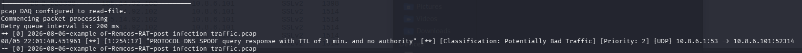
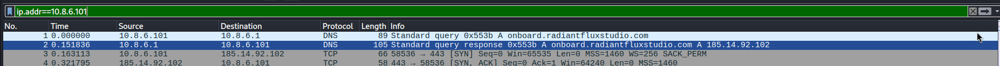
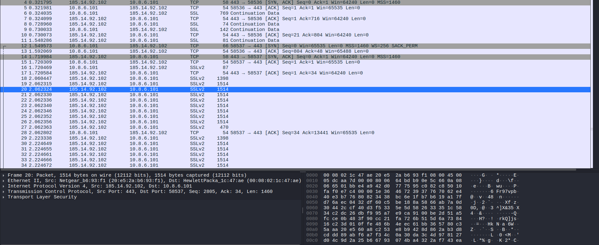
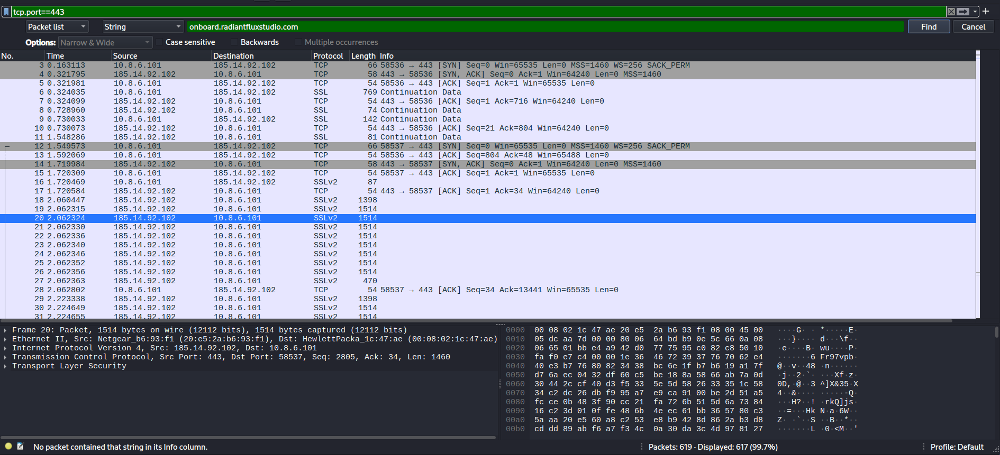
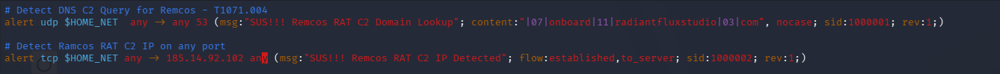
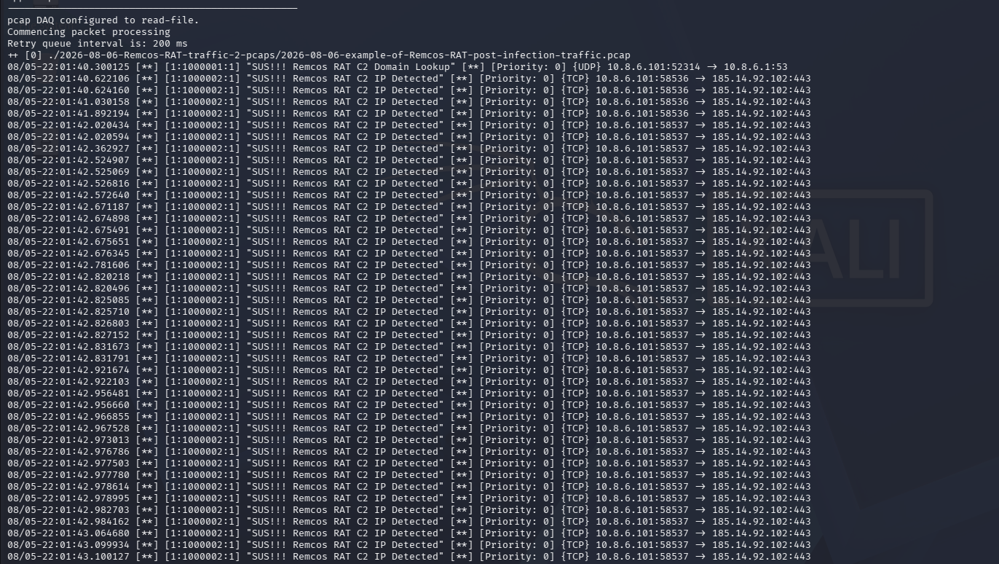

# Remcos-RAT-LAB

## Malware Traffic Analysis Report: Remcos RAT Command and Control

- **Report ID:** MTA-2025-002
- **Date:** 19th October 2026
- **Tool:** Snort (IDS mode) + Wireshark
- **Dataset:** Remcos RAT PCAP (from [Malware Analysis Site](https://malware-traffic-analysis.net))

---

## Executive Summary

A PCAP containing Remcos RAT infection traffic was analyzed using Snort 3 on my Kali Linux virtual machine and Wireshark. Community rules produced an initial DNS anomaly alert, but failed to detect the actual command-and-control (C2) channel because it was encrypted over TLS. Wireshark was used to identify the victim resolving and connecting to `onboard.radiantfluxstudio.com` (185.14.92.102) on TCP/443. Custom Snort rules were written to detect the C2 infrastructure at the DNS and IP layers, and the findings were mapped to the MITRE ATT&CK framework. The DNS rule (SID 1000001) successfully flagged the domain lookup, and the IP rule (SID 1000002) successfully detected the malware beaconing to the C2 server every 60 seconds.

## Incident Overview

- **Malware:** Remcos RAT
- **Victim IP:** 10.8.6.101
- **C2 Domain:** `onboard.radiantfluxstudio.com`
- **C2 IP/Port:** 185.14.92.102:443 (TCP/TLS)
- **Protocol:** DNS (resolution) → TLS/HTTPS (C2)

## Methodology

### Phase 1: Community Rule Detection

I ran Snort using community rules downloaded from the official Snort website against the PCAP. The only alert generated was a DNS spoofing alert, as shown below:



This alert tells us that a DNS response came with a 1-minute TTL and no authority records, which is commonly used by malware to rotate C2 infrastructure (Fast Flux). It confirmed suspicious DNS activity, but neither the C2 endpoint nor the actual C2 communication was shown.

### Phase 2: Forensics Using Wireshark

Traffic was filtered by the victim IP (10.8.6.101). The following was observed:

- The victim issued a DNS query for `onboard.radiantfluxstudio.com`.
- The response resolved to 185.14.92.102.



- The victim established a TLS session to 185.14.92.102 on TCP/443.
- The TLS session showed encrypted payload being sent.



Because the C2 channel was TLS-encrypted, community rules could not inspect it. This is the detection gap the custom rules were written to close.

### Phase 3: Custom Detection and Testing

Because the traffic was encrypted, I wrote custom Snort rules targeting the specific infrastructure of this malware:

- **Rule 1 (DNS):** Detects the DNS query for the malicious domain.
- **Rule 2 (IP):** Detects any outbound connection to the known malicious C2 IP on any port.

> N/B: Wireshark analysis confirmed that the malware connected directly through the IP without sending the plaintext domain name in the TLS handshake, which is why IP and DNS rules are important. Filtering by port number in Wireshark and searching for strings that matched the domain name yielded no results, as shown below:



## Custom Snort Rules

**Rule 1: DNS C2 Domain Lookup (SID 1000001)**

```snort
# Detect DNS C2 Query for Remcos - T1071.004
alert udp $HOME_NET any -> any 53 (msg:"SUS!!! Remcos RAT C2 Domain Lookup"; content:"|07|onboard|11|radiantfluxstudio|03|com", nocase; sid:1000001; rev:1;)
```

**Rule 2: C2 IP Detection on any port (SID 1000002)**

```snort
# Detect Remcos RAT C2 IP on any port
alert tcp $HOME_NET any -> 185.14.92.102 any (msg:"SUS!!! Remcos RAT C2 IP Detected"; flow:established,to_server; sid:1000002; rev:1;)
```

A visual representation of them is shown below:



## Results and Analysis

When the custom rules were tested against the PCAP, the DNS rule fired once. However, the IP rule triggered over 40 times continuously.



Reviewing the alert timestamps (e.g., 22:01:59, 22:02:59, 22:03:59) revealed a 60-second interval. This periodic callout is a classic malware "beacon", where the RAT checks in with the C2 server for new instructions or to exfiltrate data.

## MITRE ATT&CK Framework Mapping

| Technique ID | Technique Name | Tactic | Evidence |
| --- | --- | --- | --- |
| T1071.004 | Application Layer Protocol: DNS | Command and Control | DNS query to `onboard.radiantfluxstudio.com`, detected by SID 1000001 |
| T1571 | Non-Standard Port | Command and Control | C2 communication on TCP/443 (used to bypass egress filters) |
| T1573.002 | Encrypted Channel: Asymmetric Cryptography | Command and Control | TLS session encryption, payload unreadable by IDS |
| T1568.001 | Dynamic Resolution: Fast Flux DNS | Command and Control | Community alert SID 254:17 (TTL = 1 min, no authority records) |

## Recommendations

- **Block IOCs:** Add 185.14.92.102 and `onboard.radiantfluxstudio.com` to blocklists and DNS blacklists.
- **Deploy Custom Rules:** Implement SID 1000001 and SID 1000002 into production Snort environments.
- **Behavioral Detection:** Create SIEM alerts for internal hosts making outbound TCP connections to the same IP during a time interval.
- **TLS Inspection:** Implement TLS decryption at the perimeter to inspect C2 payloads that evade SNI and DNS detection.
